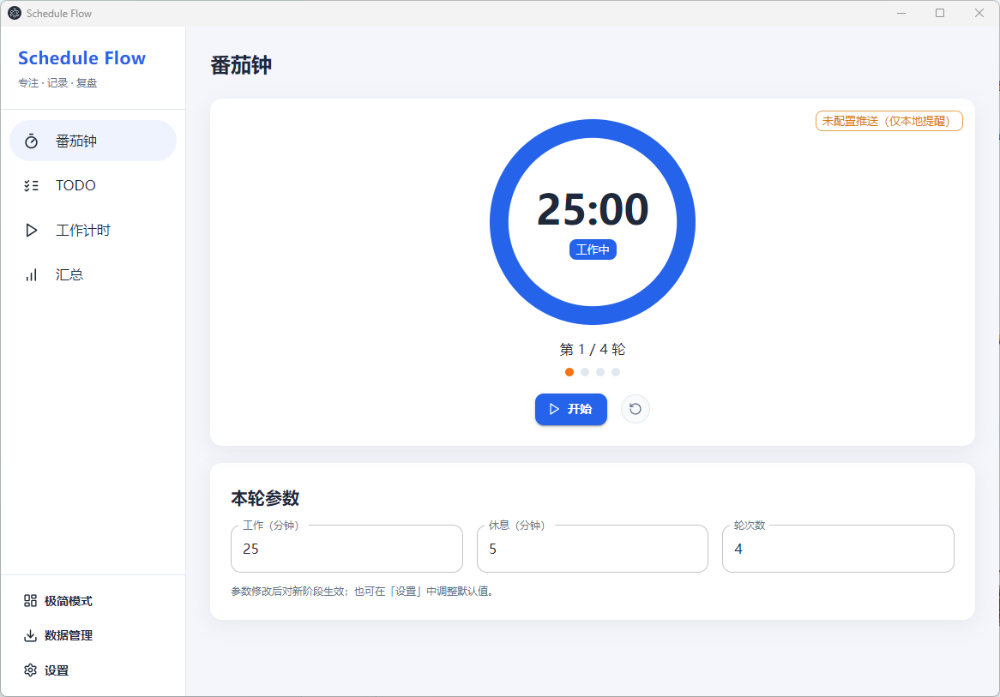
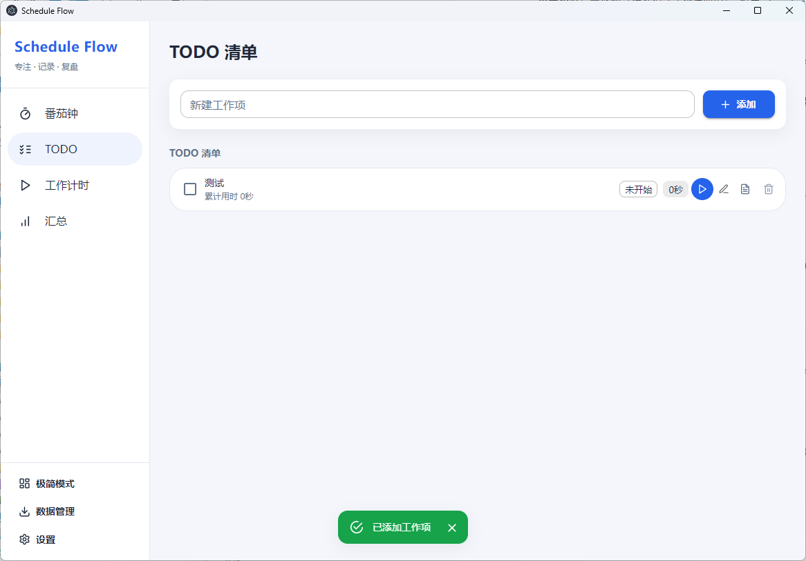
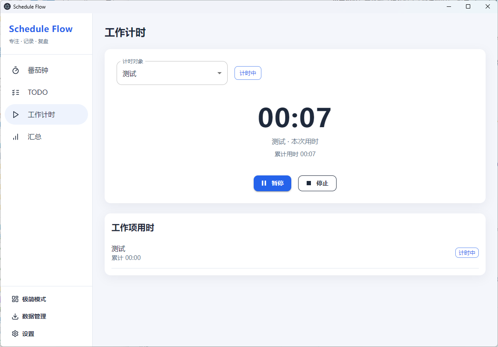
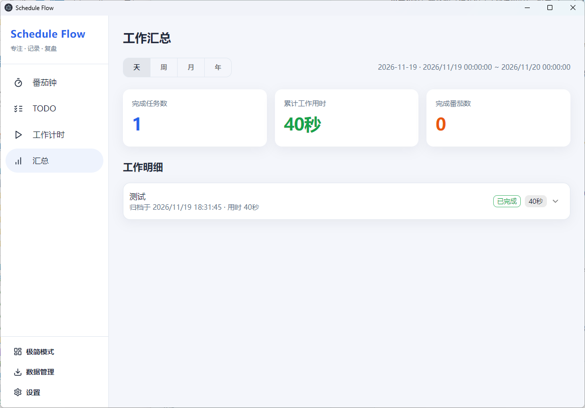
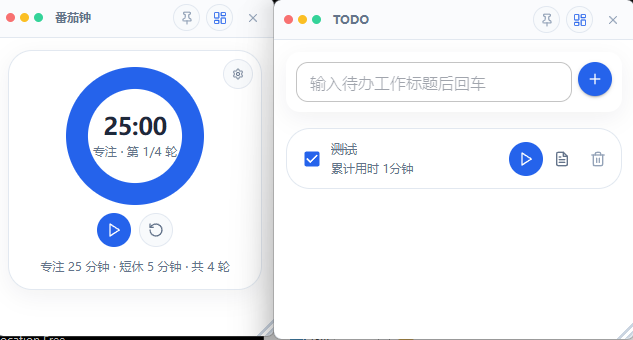

# Schedule Flow · 个人日程 + 工作汇总工具

基于 **Electron + React** 的 Windows 桌面工具：番茄钟、TODO、独立工作计时、日/周/月/年汇总。所有数据本地保存，不联网也能用（微信推送除外）。

## 界面预览

**标准模式**

| 番茄钟 | TODO 清单 |
| --- | --- |
|  |  |
| **工作计时** | **工作汇总** |
|  |  |

**极简模式 · 双独立小窗**（可拖动 / 缩放 / 单独置顶，托盘常驻）



## 下载安装

到 [Releases](https://github.com/LightFlash/schedule-flow/releases) 页面下载：

- **安装版**：`Schedule Flow-1.0.3-x64.exe`，双击按向导安装（可自选目录，创建桌面/开始菜单快捷方式）。
- **便携版**：`Schedule-Flow-1.0.3-portable.rar`，用 WinRAR / 7-Zip / Bandizip 解压后运行 `Schedule Flow.exe`，免安装、可放 U 盘。

> 首次运行若被 Windows Defender / 杀软提示，选择"允许"（Electron 应用未做代码签名）。

## 功能特性

**🍅 番茄钟**
- 自定义工作/休息时长与轮次（1~240 分钟 / 1~20 轮），改动即时生效到下一阶段
- 圆环倒计时 + 轮次进度点；开始/暂停/继续/重置
- 到点**强提醒**：窗口置顶 + 高亮闪烁 + 需手动确认
- 可选**微信推送**（Server酱 / PushPlus，双渠道同发）

**✅ TODO 清单**
- 新建/编辑/完成勾选/删除（二次确认）
- **行内直接开始/暂停/继续/停止计时**，无需展开；累计用时实时走动（分钟级显示）
- **富文本备注/心得**（加粗/斜体/下划线/列表/标题），锚定按钮的浮层内编辑
- 状态徽标 + 每项累计用时

**⏱ 工作计时**
- **多任务并发计时**：多个工作项可同时计时，各自独立开始/暂停/继续/停止，互不影响
- **新开置顶**：首次开始某一项时自动移到计时区块顶部；暂停/继续不改变顺序
- 计时基于绝对时间戳，**关闭或崩溃后按真实经过时间恢复**（多开时每项都恢复）
- 停止时自动结算到该项累计用时（可设置完成后自动勾选）；勾选完成只停该项
- 工作计时页顶部显示「进行中 N 项 · 本次合计」，支持一键全部停止

**📊 工作汇总**
- 日/周/月/年四种粒度（周一起算）
- 完成任务数、累计工作用时、完成番茄数，每项工作明细可展开

**🪟 极简模式（独立双小窗）**
- 番茄钟与 TODO 变成两个**真正独立的系统窗口**：自由拖动、右下角缩放、**单独置顶**、单独关闭
- 布局（位置/尺寸/置顶）跨启动记忆
- **托盘常驻**：关闭窗口只是隐藏，计时/提醒后台继续；托盘左键显隐、右键显示/退出
- 随时一键切回标准模式

**💾 数据管理**
- 一键导出 JSON 备份 / 导入恢复（换电脑迁移）
- 自动备份：每次退出在数据目录留带日期副本
- **卸载重装自动回初始状态**：重装后设置/窗口布局重置，TODO 与番茄钟记录保留
- **开机自启动**开关（写入系统登录项，可随时开关）

## 微信推送配置（可选）

1. 「设置」中选择渠道：
   - **Server酱 Turbo**：<https://sct.ftqq.com/> 微信扫码登录，复制 `SCT` 开头的 SendKey
   - **PushPlus**：<https://www.pushplus.plus/> 微信扫码登录，复制 Token
2. 粘贴保存后点「测试推送」确认手机收到
3. 两渠道可同时启用；推送失败不影响本地窗口强提醒

## 从源码构建（Windows，Node ≥ 18）

```bash
npm install         # 安装依赖（Electron 二进制下载慢可用 ELECTRON_MIRROR=npmmirror 镜像）
npm run dev         # 开发调试
npm run typecheck   # 类型检查
npm run build       # 构建三端产物到 out/
npm run dist        # 打包安装包到 dist/
```

打包配置见 `electron-builder.yml`（NSIS 安装包，默认图标，未签名）。

## 测试

```bash
node tests/run.mjs   # 64 项测试（零第三方依赖，Node 内置 test runner）
```

覆盖：时间工具、汇总周期、番茄/工作计时状态机、提醒与推送、IPC 契约（三端一致性）、托盘与多窗口行为、开机自启、全新安装语义、窗口几何边界。

## 目录结构

```
src/shared/    共享类型、IPC 通道常量、时间工具
src/main/      主进程：窗口管理、计时引擎、持久化、推送、提醒、汇总
src/preload/   contextBridge 安全桥接层
src/renderer/  React 界面：四个视图 + 小窗外壳 + 设置/提醒弹窗 + 主题
docs/          PRD、多窗口架构设计、类图/时序图
tests/         单元测试（tests/run.mjs 一键运行）
```

## 数据存储

数据存于 `%APPDATA%\schedule-flow\config.json`（不在安装目录），原子写入：

| 场景 | 行为 |
| --- | --- |
| 更新软件（覆盖安装或卸载重装） | **配置与数据全部保留**：推送凭证、番茄参数、计时运行态、窗口布局、TODO 与番茄钟记录 |
| 布局结构跨版本变化 | 仅窗口布局一次性重置为新结构，其余不动 |
| 换电脑 | 旧机「数据管理 → 导出」，新机「导入恢复」 |
| 防误删 | 打开「自动备份」，每次退出留带日期副本 |

进行中的计时持久化开始时间戳，重启后按真实经过时间恢复；番茄钟与工作计时是两个独立计时器，互不干扰。

## License

MIT
