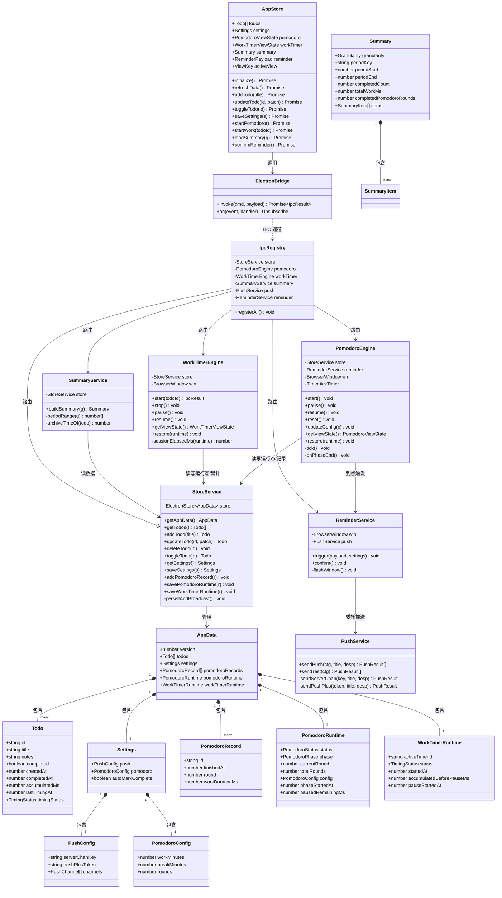
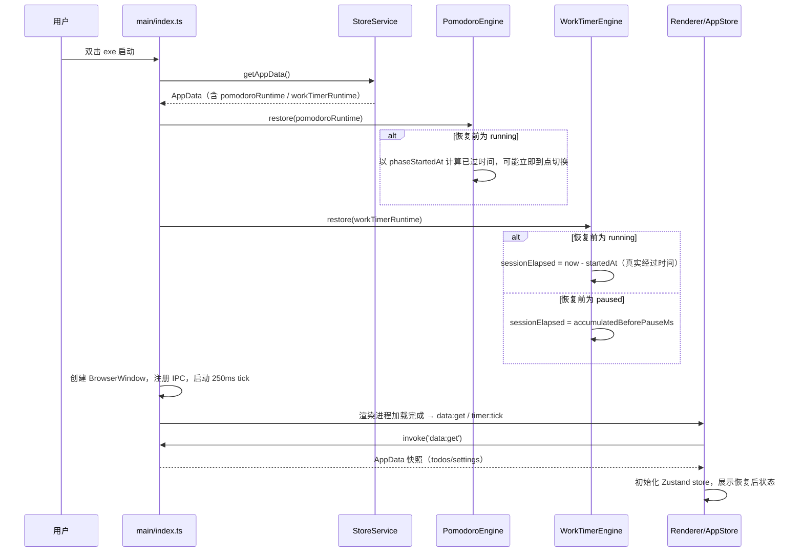
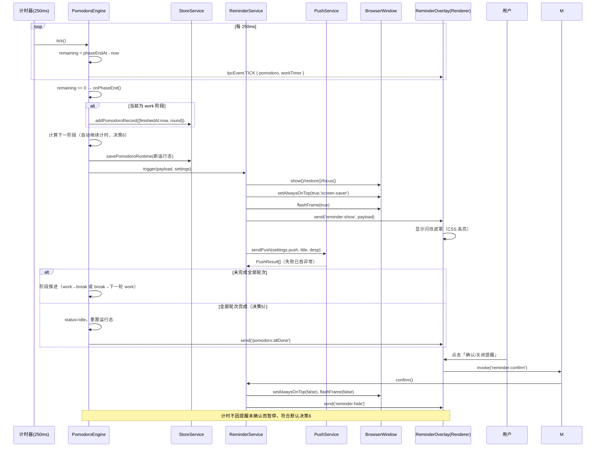
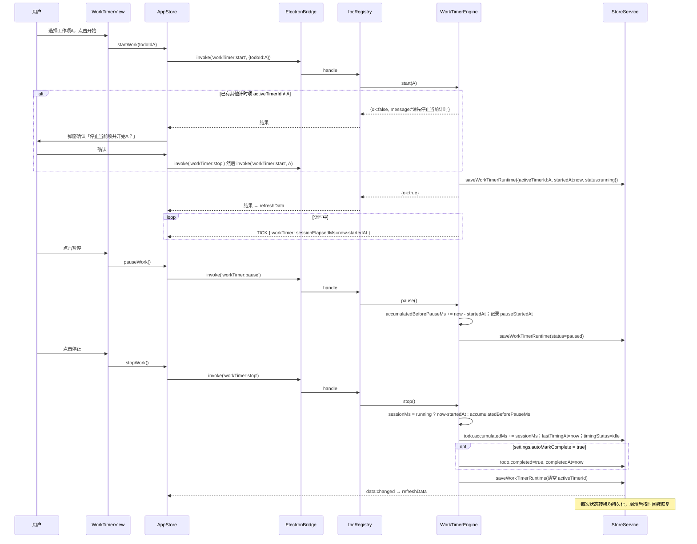
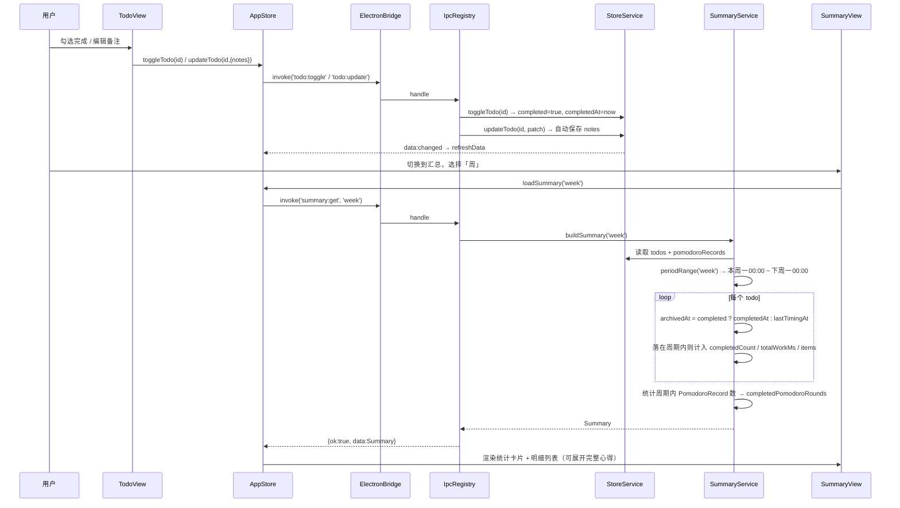
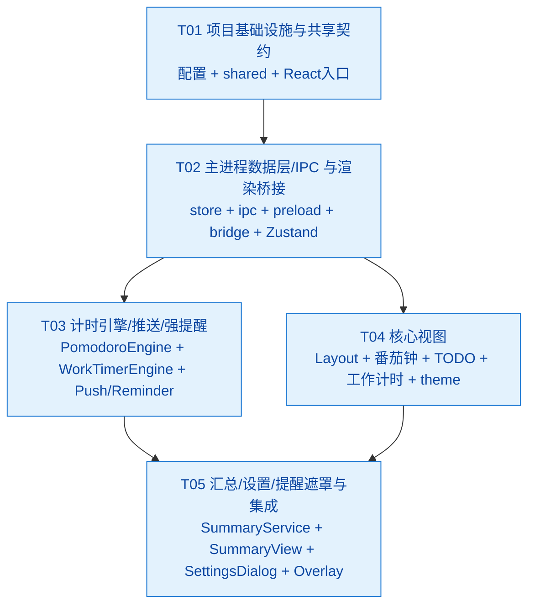

# 个人日程 + 工作汇总桌面工具 — 系统设计文档

| 项目 | 内容 |
| --- | --- |
| 文档语言 | 中文 |
| 文档版本 | v1.0 |
| 架构师 | 高见远（Gao） |
| 项目代号 | `schedule_flow` |
| 上游输入 | `docs/PRD.md`（v1.0，产品经理许清楚） |
| 技术栈 | Electron + React + TypeScript + Vite（electron-vite）+ MUI + Zustand |
| 交付形态 | Windows exe（electron-builder，首版不签名）+ 完整源码 |

---

# Part A · 系统设计

## 1. 实现方案与技术选型

### 1.1 核心技术难点

| 难点 | 说明 | 应对策略 |
| --- | --- | --- |
| 后台计时不中断 | 切换视图、渲染进程重载时倒计时不能停（P0-B5） | 计时引擎放**主进程**，以 `Date.now()` 绝对时间戳为准，不依赖 `setInterval` 累加；渲染层只展示 |
| 崩溃/关闭恢复计时 | 进行中的计时重启后按真实经过时间恢复（P0-D6） | 计时运行态（开始时间戳、暂停前累计）持久化到 store；启动时按 `now - startedAt` 还原 |
| 强提醒持续到确认 | 置顶 + 闪烁 + 推送，直到用户确认（P0-B4/F4） | 主进程 `setAlwaysOnTop(true,'screen-saver')` + `flashFrame(true)` + 渲染层闪烁遮罩；推送失败吞掉异常不影响本地提醒 |
| 单一计时互斥 | 同一时刻仅一项计时（P0-D5） | 主进程保存单一 `activeTimerId`，开始新项前由渲染层弹出确认，主进程强制先 stop 再 start |
| 汇总归档口径 | 完成时间归档、未完成按最后计时时间归档（决策4） | 统一的纯函数周期计算模块 `shared/time.ts`，主进程汇总服务一次算清 |
| 本地持久化原子性 | 避免 JSON 写坏（决策5） | `electron-store`（底层 conf，写临时文件后 rename 原子替换） |

### 1.2 架构模式

采用 **主进程权威（Main-Authoritative）+ 渲染进程视图缓存** 的分层：

- **主进程（Main）**：唯一数据源（electron-store）、两个计时引擎、推送/提醒服务、汇总计算、IPC 路由。所有写操作在此收敛，保证一致性与崩溃恢复。
- **Preload**：`contextBridge` 暴露受控的 `window.electronAPI`，隔离 Node 能力，渲染层不直接接触 `ipcRenderer`。
- **渲染进程（Renderer）**：React 组件 + Zustand store（数据缓存与 UI 状态），通过 IPC 命令读写，通过 IPC 事件接收 tick / 提醒 / 数据变更。

```
┌─────────────────────────────────────────────────────────┐
│ Renderer (React + Zustand + MUI)                        │
│  Views / Components → useAppStore → bridge(window.electronAPI) │
└───────────────────────┬─────────────────────────────────┘
                        │ IPC (invoke/handle 命令 + send/on 事件)
┌───────────────────────▼─────────────────────────────────┐
│ Preload (contextBridge)                                 │
└───────────────────────┬─────────────────────────────────┘
                        │
┌───────────────────────▼─────────────────────────────────┐
│ Main (权威层)                                            │
│  IpcRegistry → PomodoroEngine / WorkTimerEngine          │
│             → StoreService → electron-store(JSON)        │
│             → ReminderService → PushService(HTTP)        │
└─────────────────────────────────────────────────────────┘
```

### 1.3 构建与依赖选型

| 关注点 | 选择 | 理由 |
| --- | --- | --- |
| 构建工具 | **electron-vite**（内置 Vite 5） | 一套配置同时构建 main / preload / renderer 三端，HMR 友好，比手写多份 Vite 配置省事 |
| UI 库 | **MUI v6 + Emotion + @mui/icons-material** | 现代 Material 风格、圆角卡片（Paper/Card）、柔和阴影（elevation）、图标齐全，契合设计稿；用自定义 Theme 统一浅色基调 |
| 状态管理 | **Zustand** | 轻量、按 selector 订阅（倒计时高频更新只重渲染相关组件），比 Redux 样板代码少 |
| 持久化 | **electron-store v8** | 基于 conf，原子写入、默认存于 `app.getPath('userData')`，零配置 |
| 打包 | **electron-builder**（首版不签名） | Windows NSIS exe，配置成熟 |
| HTTP 推送 | **Node 22 内置 `fetch`** | 无需引入 axios；两个渠道均为简单 POST JSON/表单 |
| 图表 | 首版**不引入**图表库，汇总视图留图表占位区（P2） | 控制源文件数量与实现轮次 |

> 时间单位统一为**毫秒（number）**存储与计算，UI 展示时再换算分钟/秒（见第 8 节共享知识）。

### 1.4 推送 HTTP 调用方式

| 渠道 | 端点 | 方法/格式 | 凭证 |
| --- | --- | --- | --- |
| Server酱（Turbo） | `https://sctapi.ftqq.com/{sendkey}.send` | POST，`application/x-www-form-urlencoded`：`title`（必填）、`desp`（正文） | SendKey |
| PushPlus | `https://www.pushplus.plus/send` | POST JSON：`{ token, title, content, template:'markdown' }` | Token |

- 两渠道可同时填写，同时推送（决策2）；单渠道失败不影响另一渠道，也不影响本地提醒。
- `fetch` 加 `AbortSignal.timeout(8000)` 防网络卡死；响应 JSON 的 `code` 判定成功（Server酱 `code===0`，PushPlus `code===200`）。
- 端点 URL 以各平台最新官方文档为准，实现时集中写在 `pushService.ts` 常量区便于调整。

### 1.5 Electron API 用法（强提醒）

| 能力 | API | 位置 |
| --- | --- | --- |
| 窗口全局置顶 | `win.setAlwaysOnTop(true, 'screen-saver')` | reminderService（主进程） |
| 取消置顶 | `win.setAlwaysOnTop(false)` | 用户确认后 |
| 任务栏闪烁 | `win.flashFrame(true)`（Windows） | 主进程 |
| 窗口内容高亮闪烁 | 渲染层 `ReminderOverlay` CSS `@keyframes` 边框/背景闪烁 | 渲染层 |
| 唤出窗口 | `win.show() / win.restore() / win.focus()` | 提醒触发时 |
| 阶段结束事件 | `win.webContents.send('reminder:show', payload)` | 主进程 → 渲染层 |

### 1.6 计时引擎口径（两个独立计时器，决策2）

- **PomodoroEngine**：状态机 `idle → running ⇄ paused → idle`，阶段 `work ⇄ break`。每次 tick（主进程 250ms）用 `now` 与 `phaseEndAt` 比较判定到点；到点时先触发提醒（计时自动进入下一阶段、提醒需确认但不阻塞计时，决策6），工作阶段完成写入一条 `PomodoroRecord` 供汇总；最后一轮休息结束自动停止并提示（决策5）。
- **WorkTimerEngine**：状态机 `idle → running ⇄ paused → idle`；startedAt 驱动本次时长；停止时把本次时长累加到 `Todo.accumulatedMs` 并更新 `lastTimingAt`；`autoMarkComplete` 为真时联动勾选完成（默认 false，手动确认）。运行态每次状态转换即持久化，启动时恢复。

---

## 2. 文件列表（相对路径）

> 根目录：`C:/Users/LighFlash/WorkBuddy/2026-11-19-09-33-32/scheduleflow`
> 共 6 个配置文件 + 23 个源文件（main 7 / shared 3 / preload 1 / renderer 12）。

### 2.1 配置文件

| 文件 | 职责 |
| --- | --- |
| `package.json` | 依赖声明、脚本（dev / build / dist）、Electron 入口 |
| `electron.vite.config.ts` | electron-vite 三端（main/preload/renderer）构建配置 |
| `tsconfig.json` | TypeScript 编译选项与路径别名（`@shared`、`@renderer`） |
| `electron-builder.yml` | Windows NSIS 打包配置（appId、图标、输出目录、不签名） |
| `index.html` | 渲染进程 HTML 挂载点 |
| `.gitignore` | 忽略 node_modules / dist / out 等 |

### 2.2 共享层 `src/shared/`

| 文件 | 职责 |
| --- | --- |
| `src/shared/types.ts` | 全部核心 TypeScript 类型（Todo、Settings、Pomodoro、Timer、Summary、IPC payload） |
| `src/shared/ipcChannels.ts` | IPC 通道常量枚举（`IpcCommand` / `IpcEvent`），杜绝魔法字符串 |
| `src/shared/time.ts` | 纯函数：毫秒/分钟换算、天/周/月/年周期边界与 key、时长格式化 |

### 2.3 主进程 `src/main/`

| 文件 | 职责 |
| --- | --- |
| `src/main/index.ts` | 主进程入口：创建 BrowserWindow、初始化引擎、注册 IPC、生命周期与启动恢复 |
| `src/main/store.ts` | electron-store 封装：AppData 读写、默认值、变更广播、原子持久化 |
| `src/main/timers/PomodoroEngine.ts` | 番茄钟引擎：状态机、阶段自动切换、到点触发提醒、轮次记录 |
| `src/main/timers/WorkTimerEngine.ts` | 工作计时引擎：单计时互斥、暂停/继续、停止累加、崩溃恢复 |
| `src/main/services/ipc.ts` | IPC 路由注册：把命令分发到 store / 引擎 / 服务，统一返回 `{ok,data,message}` |
| `src/main/services/pushService.ts` | Server酱 / PushPlus HTTP 推送封装与测试推送 |
| `src/main/services/reminderService.ts` | 强提醒编排：置顶、闪烁、唤出、触发推送、确认后复位 |

### 2.4 预加载 `src/preload/`

| 文件 | 职责 |
| --- | --- |
| `src/preload/index.ts` | contextBridge 暴露 `window.electronAPI`（invoke 命令 + on 事件订阅），类型来自 shared |

### 2.5 渲染层 `src/renderer/`

| 文件 | 职责 |
| --- | --- |
| `src/renderer/main.tsx` | React 入口：createRoot 挂载 App，引入全局样式 |
| `src/renderer/App.tsx` | 根组件：订阅 store 初始化、组装 Layout、视图路由、设置弹窗与提醒遮罩挂载 |
| `src/renderer/theme.ts` | MUI 主题：浅色现代风格、圆角/阴影/配色统一 |
| `src/renderer/api/bridge.ts` | 类型化封装 `window.electronAPI`，集中处理 `{ok,data,message}` 解包与错误提示 |
| `src/renderer/store/useAppStore.ts` | Zustand store：todos/settings/计时视图态/summary/UI 状态与全部 actions |
| `src/renderer/components/Layout.tsx` | 应用外壳：标题栏、左侧导航、内容区、底部设置入口 |
| `src/renderer/components/SettingsDialog.tsx` | 设置弹窗：推送配置（渠道/凭证/测试）、番茄默认参数、保存/取消 |
| `src/renderer/components/ReminderOverlay.tsx` | 强提醒遮罩：高亮闪烁动画、提醒文案、确认按钮 |
| `src/renderer/views/PomodoroView.tsx` | 番茄钟视图：圆环倒计时、阶段/轮次、开始/暂停/继续/重置、参数快捷设置 |
| `src/renderer/views/TodoView.tsx` | TODO 视图：新建、列表勾选、用时徽标、备注自动保存、编辑/删除、快捷计时 |
| `src/renderer/views/WorkTimerView.tsx` | 工作计时视图：对象选择、大号计时（累计+本次）、启停/暂停继续、计时列表 |
| `src/renderer/views/SummaryView.tsx` | 汇总视图：天/周/月/年切换、统计卡片（完成任务数/累计工作用时/**完成番茄数**，口径见第 5 节裁决）、明细列表（可展开心得）、图表占位 |

### 2.6 目录树

```
scheduleflow/
├── package.json
├── electron.vite.config.ts
├── tsconfig.json
├── electron-builder.yml
├── index.html
├── .gitignore
└── src/
    ├── shared/
    │   ├── types.ts
    │   ├── ipcChannels.ts
    │   └── time.ts
    ├── main/
    │   ├── index.ts
    │   ├── store.ts
    │   ├── timers/
    │   │   ├── PomodoroEngine.ts
    │   │   └── WorkTimerEngine.ts
    │   └── services/
    │       ├── ipc.ts
    │       ├── pushService.ts
    │       └── reminderService.ts
    ├── preload/
    │   └── index.ts
    └── renderer/
        ├── main.tsx
        ├── App.tsx
        ├── theme.ts
        ├── api/
        │   └── bridge.ts
        ├── store/
        │   └── useAppStore.ts
        ├── components/
        │   ├── Layout.tsx
        │   ├── SettingsDialog.tsx
        │   └── ReminderOverlay.tsx
        └── views/
            ├── PomodoroView.tsx
            ├── TodoView.tsx
            ├── WorkTimerView.tsx
            └── SummaryView.tsx
```

---

## 3. 数据结构与接口

### 3.1 核心类型定义（`src/shared/types.ts`）

```ts
// ===== 基础枚举 =====
export type TimingStatus = 'idle' | 'running' | 'paused';        // 未开始/计时中/已暂停
export type PomodoroStatus = 'idle' | 'running' | 'paused';
export type PomodoroPhase = 'work' | 'break';
export type Granularity = 'day' | 'week' | 'month' | 'year';
export type PushChannel = 'serverchan' | 'pushplus';
export type ViewKey = 'pomodoro' | 'todo' | 'worktimer' | 'summary';

// ===== 数据模型 =====
export interface Todo {
  id: string;                 // uuid
  title: string;
  notes: string;              // 备注/心得，自动保存
  completed: boolean;
  createdAt: number;          // 毫秒时间戳
  completedAt: number | null; // 完成时刻，未完成为 null
  accumulatedMs: number;      // 累计工作用时（毫秒）
  lastTimingAt: number | null;// 最后计时时刻（归档用）
  timingStatus: TimingStatus; // 与全局 activeTimerId 联动展示
}

export interface PomodoroConfig {
  workMinutes: number;        // 默认 25
  breakMinutes: number;       // 默认 5
  rounds: number;             // 默认 4
}

export interface PushConfig {
  serverChanKey: string;      // Server酱 SendKey
  pushPlusToken: string;      // PushPlus Token
  channels: PushChannel[];    // 启用的渠道；两者都有则都推送
}

export interface Settings {
  push: PushConfig;
  pomodoro: PomodoroConfig;   // 默认参数
  autoMarkComplete: boolean;  // 停止计时后自动标记完成，默认 false
}

export interface PomodoroRecord {
  id: string;
  finishedAt: number;         // 工作阶段完成时刻（归档用）
  round: number;
  workDurationMs: number;
}

// ===== 计时运行态（持久化，支持崩溃恢复）=====
export interface PomodoroRuntime {
  status: PomodoroStatus;
  phase: PomodoroPhase;
  currentRound: number;       // 1-based
  totalRounds: number;
  config: PomodoroConfig;
  phaseStartedAt: number | null;   // 当前阶段开始时间戳（running 时）
  pausedRemainingMs: number;       // 暂停时的剩余毫秒
}

export interface WorkTimerRuntime {
  activeTimerId: string | null;    // 单一计时对象（todo.id）
  status: TimingStatus;
  startedAt: number | null;        // 本次计时开始时间戳（running 时）
  accumulatedBeforePauseMs: number;// 本次计时中暂停前累计毫秒
  pauseStartedAt: number | null;   // 暂停开始时间戳
}

// ===== 持久化根对象 =====
export interface AppData {
  version: number;                 // 数据结构版本，便于迁移
  todos: Todo[];
  settings: Settings;
  pomodoroRecords: PomodoroRecord[];
  pomodoroRuntime: PomodoroRuntime;
  workTimerRuntime: WorkTimerRuntime;
}

// ===== 渲染层视图态（由主进程 tick 推送）=====
export interface PomodoroViewState {
  status: PomodoroStatus;
  phase: PomodoroPhase;
  currentRound: number;
  totalRounds: number;
  remainingMs: number;
  totalPhaseMs: number;            // 用于进度环比例
  config: PomodoroConfig;
}

export interface WorkTimerViewState {
  status: TimingStatus;
  activeTodoId: string | null;
  activeTitle: string;
  sessionElapsedMs: number;        // 本次已计时（不含累计）
  activeAccumulatedMs: number;     // 该工作项累计用时
}

// ===== 汇总 =====
export interface SummaryItem {
  todoId: string;
  title: string;
  archivedAt: number;
  accumulatedMs: number;
  completed: boolean;
  notesPreview: string;
}

export interface Summary {
  granularity: Granularity;
  periodKey: string;               // '2026-11-19' / '2026-W47' / '2026-11' / '2026'
  periodStart: number;
  periodEnd: number;
  completedCount: number;
  totalWorkMs: number;
  completedPomodoroRounds: number;
  items: SummaryItem[];
}

// ===== IPC 通用返回 =====
export interface IpcResult<T = unknown> {
  ok: boolean;
  data?: T;
  message?: string;
}

export interface PushResult {
  channel: PushChannel;
  ok: boolean;
  message: string;
}

export interface ReminderPayload {
  phase: PomodoroPhase;
  title: string;
  message: string;
}
```

### 3.2 IPC 通道（`src/shared/ipcChannels.ts`）

命名规范：命令 `域:动作`（renderer→main，`invoke/handle`）；事件 `域:事件`（main→renderer，`send/on`）。

```ts
export const IpcCommand = {
  // 数据
  GET_DATA:        'data:get',
  TODO_ADD:        'todo:add',
  TODO_UPDATE:     'todo:update',
  TODO_DELETE:     'todo:delete',
  TODO_TOGGLE:     'todo:toggle',
  SETTINGS_SAVE:   'settings:save',
  SETTINGS_TEST_PUSH: 'settings:testPush',
  // 番茄钟
  POMODORO_START:  'pomodoro:start',
  POMODORO_PAUSE:  'pomodoro:pause',
  POMODORO_RESUME: 'pomodoro:resume',
  POMODORO_RESET:  'pomodoro:reset',
  POMODORO_CONFIG: 'pomodoro:updateConfig',
  // 工作计时
  WORK_START:      'workTimer:start',
  WORK_STOP:       'workTimer:stop',
  WORK_PAUSE:      'workTimer:pause',
  WORK_RESUME:     'workTimer:resume',
  // 汇总与提醒
  SUMMARY_GET:     'summary:get',
  REMINDER_CONFIRM:'reminder:confirm',
} as const;

export const IpcEvent = {
  TICK:            'timer:tick',          // { pomodoro, workTimer }
  DATA_CHANGED:    'data:changed',        // todos/settings/records 变更
  REMINDER_SHOW:   'reminder:show',       // ReminderPayload
  REMINDER_HIDE:   'reminder:hide',
  POMODORO_ALL_DONE:'pomodoro:allDone',   // 全部轮次完成提示
} as const;
```

### 3.3 关键服务接口（类图）



> `SummaryItem` 与枚举类型定义见 3.1，类图中省略以保持可读性。

---

## 4. 程序调用流程（时序图）

### 4.1 应用启动与崩溃恢复



### 4.2 番茄钟到点 → 强提醒（工作/休息结束均触发）



### 4.3 工作计时启停 / 暂停 / 互斥切换



### 4.4 TODO 完成 → 汇总归档



---

## 5. Anything UNCLEAR（待明确事项 / 已采用的默认决策）

**已按 PRD 默认口径直接采用的决策**（无需再确认，如有变更需回归产品）：

1. 打包工具 = `electron-builder`，首版不签名（PRD Q1）。
2. 两个推送渠道首版均支持，同时填写则都推送（PRD Q2）。
3. 首版仅中文（PRD Q3）。
4. 首版不自动备份（PRD Q4），手动导出列 P1。
5. 番茄钟完成全部轮次后自动停止并提示（PRD Q5）。
6. 阶段结束后自动进入下一阶段计时，提醒需用户确认但计时继续（PRD Q6）。
7. 停止计时后默认**不自动**标记完成，`autoMarkComplete` 默认 false（PRD 决策1）。

**开放点已由产品经理裁决确认（2026-11-19，产品侧无异议、PRD 无需变更）**：

- **Server酱版本**：确认为 **Turbo 版**（端点 `https://sctapi.ftqq.com/{sendkey}.send`）；端点常量集中在 `pushService.ts`，按此实现，无变更。
- **汇总番茄计数口径**：确认为**按 work 阶段完成次数计**，休息结束不计；最后一轮即便未走完休息段，专注本身也算完成并计入。按"完整轮次（work+break）"计的方案**不采用**。数据模型 `completedPomodoroRounds` 与 `SummaryService.buildSummary` 逻辑保持不变。
- **指标卡文案**：统一使用 **「完成番茄数」**（不写"完成番茄轮次数"），仅 UI 文案层调整，不动数据模型与 `SummaryService`。
- **图标/品牌资源**：首版用内置占位图标（electron-builder 需 256×256 `.ico`），若无设计资源则用默认图标，不影响功能验收。
- **多显示器 / 高 DPI**：`alwaysOnTop('screen-saver')` 在 Windows 多屏下置顶到主屏，首版不处理跨屏跟随。

---

# Part B · 任务分解

## 6. Required Packages（依赖包列表）

### 6.1 `dependencies`

```json
{
  "electron-store": "^8.2.0",
  "react": "^18.3.1",
  "react-dom": "^18.3.1",
  "@mui/material": "^6.1.0",
  "@mui/icons-material": "^6.1.0",
  "@emotion/react": "^11.13.0",
  "@emotion/styled": "^11.13.0",
  "zustand": "^5.0.0"
}
```

| 包 | 用途 |
| --- | --- |
| `electron-store` | 本地 JSON 原子持久化（AppData） |
| `react` / `react-dom` | UI 框架 |
| `@mui/material` | 现代 UI 组件（Paper/Card/Button/Dialog/Tabs 等） |
| `@mui/icons-material` | 导航与操作图标 |
| `@emotion/react` / `@emotion/styled` | MUI 样式引擎 |
| `zustand` | 渲染层状态管理（selector 订阅，适配高频 tick） |

### 6.2 `devDependencies`

```json
{
  "electron": "^33.0.0",
  "electron-vite": "^2.1.0",
  "vite": "^5.4.0",
  "typescript": "^5.6.0",
  "@types/react": "^18.3.0",
  "@types/react-dom": "^18.3.0",
  "@types/node": "^22.0.0",
  "electron-builder": "^25.1.0"
}
```

| 包 | 用途 |
| --- | --- |
| `electron` | 桌面运行时（Electron 33 内置 Node 20/22 兼容本机 Node 22 构建环境） |
| `electron-vite` | 三端构建与开发热更新 |
| `vite` | 底层构建引擎 |
| `typescript` | 类型检查与编译 |
| `@types/*` | 类型声明 |
| `electron-builder` | 打包 Windows NSIS exe |

> 推送使用 Node 22 内置 `fetch`，无需 axios/node-fetch。图表首版不引入第三方库。

---

## 7. Task List（按依赖顺序）

> 约束：≤5 个任务；每任务 ≥3 个相关文件；T01 为项目基础设施；避免长线性链（T03/T04 仅依赖 T02，可并行）。

### T01 — 项目基础设施与共享契约
- **优先级**：P0
- **依赖**：无
- **源文件**：
  - `package.json`（依赖与脚本：dev / build / dist）
  - `electron.vite.config.ts`（三端构建配置）
  - `tsconfig.json`（编译选项 + `@shared`/`@renderer` 别名）
  - `electron-builder.yml`（Windows NSIS，不签名）
  - `index.html`（渲染挂载点）
  - `.gitignore`
  - `src/shared/types.ts`（全部核心类型，见 3.1）
  - `src/shared/ipcChannels.ts`（通道常量，见 3.2）
  - `src/shared/time.ts`（毫秒/分钟换算、周期边界、时长格式化）
  - `src/renderer/main.tsx`（React 入口骨架）
  - `src/renderer/App.tsx`（根组件骨架：临时占位，后续 T05 集成）
- **验收**：`npm run dev` 可启动 Electron 空窗口并显示 React 占位页；类型检查通过。

### T02 — 主进程数据层、IPC 路由与渲染层桥接
- **优先级**：P0
- **依赖**：T01
- **源文件**：
  - `src/main/store.ts`（electron-store 封装、默认 AppData、变更广播）
  - `src/main/services/ipc.ts`（注册数据/设置类命令，统一 `IpcResult` 返回）
  - `src/main/index.ts`（主进程入口：创建窗口、初始化 store、注册 IPC、生命周期）
  - `src/preload/index.ts`（contextBridge 暴露 `window.electronAPI`）
  - `src/renderer/api/bridge.ts`（类型化封装 invoke/on，解包 `IpcResult`）
  - `src/renderer/store/useAppStore.ts`（Zustand store 骨架：todos/settings + 数据 CRUD actions）
- **验收**：渲染层可调用 `data:get`、TODO 增删改查、`settings:save`，重启后数据仍在；preload 隔离生效。

### T03 — 主进程计时引擎、推送与强提醒
- **优先级**：P0
- **依赖**：T02
- **源文件**：
  - `src/main/timers/PomodoroEngine.ts`（状态机、250ms tick、阶段自动切换、轮次记录、到点触发提醒）
  - `src/main/timers/WorkTimerEngine.ts`（单计时互斥、暂停/继续、停止累加、崩溃恢复）
  - `src/main/services/pushService.ts`（Server酱/PushPlus POST、测试推送、异常吞掉）
  - `src/main/services/reminderService.ts`（置顶/闪烁/唤出/推送编排、确认复位）
  - 修改 `src/main/services/ipc.ts`（注册番茄钟/工作计时/汇总/提醒命令 + tick 事件推送）
  - 修改 `src/main/index.ts`（启动恢复引擎、注入 BrowserWindow）
- **验收**：番茄钟到点触发置顶 + 遮罩 + 推送且计时继续；工作计时暂停/继续/互斥/停止累加正确；杀进程重启后计时按真实时间恢复。

### T04 — 核心视图：布局、番茄钟、TODO、工作计时
- **优先级**：P0
- **依赖**：T02
- **源文件**：
  - `src/renderer/theme.ts`（MUI 浅色现代主题）
  - `src/renderer/components/Layout.tsx`（标题栏/左导航/内容区/设置入口）
  - `src/renderer/views/PomodoroView.tsx`（圆环倒计时、阶段/轮次、控制按钮、参数快捷设置、推送状态提示）
  - `src/renderer/views/TodoView.tsx`（新建/勾选/用时徽标/备注自动保存/编辑删除/快捷计时）
  - `src/renderer/views/WorkTimerView.tsx`（对象选择/大号计时/启停暂停继续/计时列表）
- **验收**：四个视图中前三个可正常操作，与 store/引擎联动；切视图倒计时不中断；TODO 备注失焦即保存。

### T05 — 汇总视图、设置弹窗、提醒遮罩与整体集成
- **优先级**：P0
- **依赖**：T03、T04
- **源文件**：
  - `src/main/services/summaryService.ts`（**新增**：`buildSummary(g)`，周期归档算法）——*注：鉴于汇总逻辑独立且内聚，允许在此任务新增此文件，源文件总数仍 ≤25*
  - `src/renderer/views/SummaryView.tsx`（天/周/月/年切换、统计卡片、明细展开、图表占位）
  - `src/renderer/components/SettingsDialog.tsx`（渠道单选、凭证密码输入、测试推送、默认参数、保存取消）
  - `src/renderer/components/ReminderOverlay.tsx`（闪烁高亮遮罩、确认按钮）
  - 修改 `src/renderer/App.tsx`（集成视图路由、设置弹窗、提醒遮罩、初始化流程）
- **验收**：汇总四粒度数据正确；设置可保存并测试推送；到点遮罩闪烁且确认后取消置顶；整体走通并可执行 `npm run dist` 产出 exe。

> 说明：T05 新增 `summaryService.ts` 后，源文件总数为 24（main 8 / shared 3 / preload 1 / renderer 12），仍满足 ≤25 约束。

---

## 8. Shared Knowledge（跨文件约定）

1. **时间单位**：所有时间戳与时长均为 **毫秒（number, `Date.now()`  epoch）**；仅 UI 展示时换算为分钟/秒。`formatDuration(ms)` 统一在 `shared/time.ts`。
2. **计时状态机**：`idle → running ⇄ paused → idle`。`running` 以 `startedAt` 为准；`paused` 以 `accumulatedBeforePauseMs` 为准；每次状态转换立即持久化运行态；启动按运行态恢复（running 用真实经过时间）。
3. **单一计时互斥**：全局仅 `workTimerRuntime.activeTimerId` 一个计时对象；开始新项前主进程检查，非空则返回 `{ok:false}`，由 UI 确认后先 stop 再 start。
4. **番茄钟与工作计时相互独立**，不共用计时器；联动（P1）仅在工作阶段开始时启动选中 TODO。
5. **轮次语义**：1 轮 = work + break；work 结束记一条 `PomodoroRecord`；最后一轮 break 结束 → idle + 提示；阶段结束自动推进，提醒不阻塞计时。
6. **汇总周期算法**（`shared/time.ts` + `summaryService.ts`）：天=本地 00:00 起；周=**周一 00:00 起**（用 `(getDay()+6)%7` 回溯）；月=1 号 00:00 起；年=1 月 1 日 00:00 起。区间为左闭右开 `[start, end)`。归档时间 = `completed ? completedAt : lastTimingAt`；`totalWorkMs` = 周期内各项 `accumulatedMs` 之和。
7. **IPC 命名**：命令 `域:动作`（renderer `invoke` → main `handle`）；事件 `域:事件`（main `webContents.send` → renderer `on`）；通道字符串只在 `shared/ipcChannels.ts` 定义，禁止散落魔法字符串。
8. **统一返回**：所有命令返回 `IpcResult<T> = { ok, data?, message? }`；`bridge.ts` 负责解包，失败抛错并由 UI 提示。
9. **preload 隔离**：渲染层只能通过 `window.electronAPI` 访问 IPC，禁止在 renderer 直接 import `electron`。
10. **数据持久化**：唯一数据源为主进程 `electron-store`，文件位于 `app.getPath('userData')/config.json`；渲染层 Zustand 仅为缓存，所有变更经 IPC 写回并监听 `data:changed` 刷新。
11. **推送容错**：`reminderService` 中推送失败必须被 catch，绝不阻断本地置顶/闪烁；凭证只存本地且输入框密码态。
12. **UI 风格**：MUI 自定义 Theme 统一浅色基调、圆角（约 12–16px）、柔和阴影；四个视图共用 Layout 外壳，标题栏/左导航/底部设置入口只实现一次。
13. **汇总指标卡文案**（产品裁决）：三张卡片文案为「完成任务数」「累计工作用时」「**完成番茄数**」；番茄数按 work 阶段完成记录计（最后一轮未完成休息段也计入），数据模型与 `SummaryService` 逻辑不变，仅文案层用「完成番茄数」。

---

## 9. Task Dependency Graph



> 并行提示：T03 与 T04 之间无依赖，可由工程师连续实现或按优先级先 T03（后端引擎）后 T04（前端视图）；T05 需两者均完成后集成。

---

> 本设计以"可落地、不过度设计"为原则，源文件 24 个、任务 5 个，覆盖全部 P0 需求。工程师可直接按 T01→T05 顺序批量编码。
