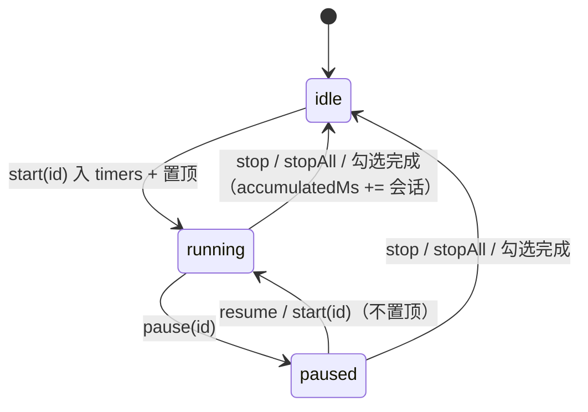
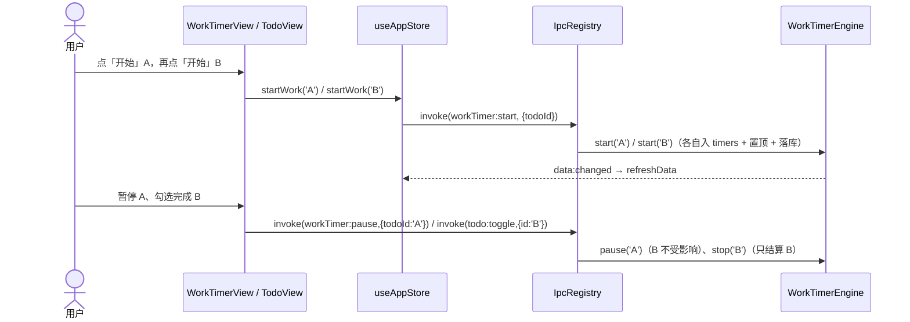
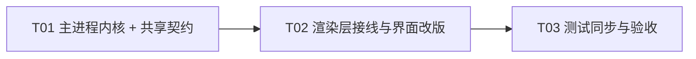

# Schedule Flow — 增量架构设计：工作计时多开（v1.0.3）

> 上游 `docs/prd-multitimer.md`。只覆盖「工作计时」；番茄钟零改动、不引第三方依赖、命令 33 → 34。

## 0. 结论速览

| 决策点 | 结论（可直接实现） |
| --- | --- |
| 运行态形态 | `workTimerRuntime = { timers: WorkTimerEntry[] }`，一条 entry = 一个进行中的工作项 |
| 权威数据 | 时间戳只在 runtime；`Todo.timingStatus` 降级为**镜像**，由引擎在每次状态转换时同步 |
| 版本号 | `AppData.version` 不升、`LAYOUT_VERSION` 不升（保持 3）；迁移按**结构**判定：有 `timers` 数组即 v2 |
| 重复 start | `paused → 继续`（不置顶）；`running → 幂等空操作`（不重置 startedAt、不开第二会话、不置顶） |
| 排序 | 只有 `idle → running` 首次开始才移到「计时区块顶部」；卡片顺序 = 清单顺序 |
| IPC | `workTimer:pause/resume/stop` 增加 `{ todoId }`；新增 `workTimer:stopAll` |
| 失败口径 | 仅「工作项不存在 / 已完成不可计时 / 载荷非法」返回 ok:false；其余幂等成功，删除「请先停止当前计时」 |

## 1. 数据模型

### 1.1 类型定义（`src/shared/types.ts` 整段替换 `WorkTimerRuntime`）

```ts
export type ActiveTimingStatus = Exclude<TimingStatus, 'idle'>; // 'running' | 'paused'
export interface WorkTimerEntry {        // 单条计时会话（持久化，支持崩溃恢复）
  todoId: string;
  status: ActiveTimingStatus;
  startedAt: number | null;              // running 必有；paused 为 null
  accumulatedBeforePauseMs: number;      // 本次会话「暂停前」已累计
  pauseStartedAt: number | null;         // paused 必有
}
export interface WorkTimerRuntime { timers: WorkTimerEntry[] }  // v2：唯一数据源，顺序无意义
export interface WorkTimerRuntimeV1 {    // v1.0.2 遗留单计时，仅 store 迁移时读取
  activeTimerId: string | null; status: TimingStatus; startedAt: number | null;
  accumulatedBeforePauseMs: number; pauseStartedAt: number | null;
}
export interface WorkTimerEntryView {
  todoId: string; title: string; status: ActiveTimingStatus;
  sessionElapsedMs: number;              // 本次会话用时
  accumulatedMs: number;                 // 历史累计（不含本次）
  totalAccumulatedMs: number;            // 两者之和，渲染层直接显示
}
export interface WorkTimerViewState { entries: WorkTimerEntryView[]; totalSessionElapsedMs: number }
export interface WorkTargetPayload { todoId: string }  // WORK_START/PAUSE/RESUME/STOP 统一载荷
```

新增纯函数模块 `src/shared/workTimerRuntime.ts`（无 Electron 依赖，主进程与测试共用）：
`emptyWorkTimerRuntime()`、`normalizeWorkTimerRuntime(raw: unknown)`（v1→v2 + 结构净化，见 1.4）、`findWorkTimerEntry(rt, todoId)`、`sessionElapsedMsOf(entry, now)`。

### 1.2 字段语义（会话用时唯一公式）

| 字段 | running | paused | 说明 |
| --- | --- | --- | --- |
| `startedAt` | 本次 running 段起点 | `null` | 恢复时用 `now - startedAt` 补齐程序关闭期间 |
| `accumulatedBeforePauseMs` | 本会话此前已跑完的毫秒 | 同左（冻结） | 暂停期间不增长 |
| `pauseStartedAt` | `null` | 暂停时刻 | 仅诊断与恢复兜底，不参与结算算术 |

`running → accumulatedBeforePauseMs + max(0, now - startedAt)`；`paused → accumulatedBeforePauseMs`；无 entry → 0。

### 1.3 单条状态机（每条 entry 独立，互不影响）



### 1.4 迁移与版本

| 项 | 结论 |
| --- | --- |
| 迁移位置 | 唯一入口 `StoreService.ensureShape()`：`workTimerRuntime: normalizeWorkTimerRuntime(current.workTimerRuntime)`；启动读取与 `replaceAppData`（导入旧备份）都走它 |
| v1 转换 | 有 `timers` 数组 → 逐条净化；否则 `activeTimerId` 非空且 status 为 running/paused → 转 1 条；否则 `{ timers: [] }` |
| 累计不丢 | `accumulatedBeforePauseMs` 原样保留（夹到 `>= 0`）；`Todo.accumulatedMs` 本就在 Todo 上，天然不受影响 |
| `LAYOUT_VERSION` | **不升 3→4**：布局与运行态正交，升版会无谓重置用户窗口位置/置顶；不升 = 静默升级 |
| `AppData.version` | 保持 1 仅作历史透传；v2 判定只看结构，避免"版本号未回写导致反复迁移" |

### 1.5 重复 start 语义（P0-1 / Q2）

| 当前状态 | `start(todoId)` 结果 |
| --- | --- |
| 无 entry | 新建 entry + `moveTodoToTimerBlockTop` + `timingStatus=running` → `ok:true '已开始计时'` |
| `paused` | 继续：`startedAt=now`、`pauseStartedAt=null`、保留累计 → `ok:true '已继续计时'`，**不置顶** |
| `running` | 幂等空操作 → `ok:true '该项正在计时中'`，不动时间戳 |

## 2. 引擎 API（`src/main/timers/WorkTimerEngine.ts` 重写）

| 方法 | 签名 | 行为 |
| --- | --- | --- |
| `start` | `(todoId) => IpcResult<string>` | 见 1.5；不存在 → `ok:false '工作项不存在或已被删除'`；`completed` → `ok:false '已完成的工作项不可计时'` |
| `pause` | `(todoId) => IpcResult<void>` | 非 running 幂等 ok（含目标已消失），转 paused + 写 `timingStatus` |
| `resume` | `(todoId) => IpcResult<void>` | 非 paused 幂等 ok |
| `stop` | `(todoId) => IpcResult<void>` | 无 entry → 幂等 ok；否则 `accumulatedMs += session`、`lastTimingAt=now`、`timingStatus=idle`、从 `timers` 移除；`autoMarkComplete` 只对**该项**生效并 `moveTodoToEnd` |
| `stopAll` | `() => IpcResult<number>` | 逐条同一结算逻辑，返回结算条数（0 = 本来没在计时） |
| `getViewState` | `() => WorkTimerViewState` | 按 `store.getTodos()` 顺序输出 entries（Map 索引 runtime），tick 与首屏共用 |
| `restore` | `(raw: WorkTimerRuntime \| WorkTimerRuntimeV1 \| null) => void` | 见下，幂等，可被启动与 `data:import` 重复调用 |

- **tick**：沿用 `PomodoroEngine` 的 250ms 循环（`TickPayload.workTimer` 类型换新）。3~10 条 entry 载荷 < 1KB，频率与事件契约均不变。
- **持久化触发**：仍由 `store.saveWorkTimerRuntime` / `updateTodo` 触发 `data:changed`，不新增事件。

```ts
restore(raw):
  rt = normalizeWorkTimerRuntime(raw)                    // 导入旧备份时可能仍是 v1
  todos = store.getTodos(); byId = Map(todos); kept = []
  for (e of rt.timers):
     todo = byId.get(e.todoId)
     if (!todo || todo.completed) continue                // 悬空 / 已完成 → 只丢该项
     if (kept.some(k => k.todoId === e.todoId)) continue  // 去重
     if (e.status === 'running'):
        if (e.startedAt === null) continue                // 缺起点 → 只丢该项，不牵连其它
        kept.push({ ...e, startedAt: min(e.startedAt, now), accumulatedBeforePauseMs: max(0, e.accumulatedBeforePauseMs), pauseStartedAt: null })
     else if (e.status === 'paused'):
        kept.push({ ...e, startedAt: null, accumulatedBeforePauseMs: max(0, ...), pauseStartedAt: e.pauseStartedAt ?? now })
  kept.sort(按 todos 下标)                                 // 顺序与清单对齐
  store.saveWorkTimerRuntime({ timers: kept })
  for (todo of todos):  want = keptMap.get(todo.id)?.status ?? 'idle'   // timingStatus 全量对齐
     if (todo.timingStatus !== want) store.updateTodo(todo.id, { timingStatus: want })
```

不设单会话时长上限：真实时间优先，只做「负数归零 + 未来时间戳收敛为 now」，绝不截断已计时间。

## 3. IPC 契约

| 命令 | 常量 | 载荷 | 变更 |
| --- | --- | --- | --- |
| `workTimer:start` | `WORK_START` | `{ todoId }` | 类型改名 `WorkTargetPayload`，行为改为并发 |
| `workTimer:pause` | `WORK_PAUSE` | `{ todoId }` | **新增载荷** |
| `workTimer:resume` | `WORK_RESUME` | `{ todoId }` | **新增载荷** |
| `workTimer:stop` | `WORK_STOP` | `{ todoId }` | **新增载荷** |
| `workTimer:stopAll` | `WORK_STOP_ALL` | 无 | **新增命令**（总数 33 → 34） |

| 三端同步点 | 改动 |
| --- | --- |
| `main/services/ipc.ts` | 4 个 handler 读 `{ todoId }`（非字符串 → `fail('参数不完整')`）；新增 `WORK_STOP_ALL`；`TODO_DELETE`/`TODO_TOGGLE` 改为 `this.workTimer.stop(id)`（无 entry 幂等），彻底删掉 `getViewState().activeTodoId` 判断 |
| `preload/index.ts` | 不改（白名单来自 `Object.values(IpcCommand)`） |
| `renderer/api/bridge.ts` | `startWork(todoId)` 保持；`pauseWork/resumeWork/stopWork(todoId)`；新增 `stopAllWork(): Promise<number>` |
| `renderer/store/useAppStore.ts` | 同名 action 全部带 `todoId`；新增 `stopAllWork`；**删除**「请先停止当前计时」+ `window.confirm` 切换分支；`startWork` 返回 `Promise<void>` |
| `tests/ipcContract.test.mjs` | 33→34（3 处）、键名清单增 `WORK_STOP_ALL`、`qa.handlers.size === 34`；三端一致断言自动覆盖新命令 |

## 4. 排序语义（并发下）

| 场景 | 规则 |
| --- | --- |
| 计时区块 | 清单中 `timingStatus !== 'idle'` 的所有项；通常连续在顶部，被拖拽打散后**不强制收拢** |
| 新开（idle→running） | `moveTodoToTimerBlockTop(id)`：移除该项后插到「第一个非 idle 项」之前；无其它计时项则插到 0 |
| 暂停 / 继续 / 重复 start | 完全不动顺序（Q2） |
| stop 结算 | 位置不动（仅 `timingStatus → idle`）；`autoMarkComplete` 完成时 `moveTodoToEnd` |
| `addTodo` | 插到「**最后一个**非 idle 项」之后；无计时项则插到 0（P1-3） |
| 勾选 / 取消完成 | 不变：完成沉底 `moveTodoToEnd`；取消完成 `moveTodoToUncompletedEnd` |
| `reorderTodos`（拖拽） | 逻辑不变（子集重排语义保持），允许把计时项拖离区块 |

`StoreService` 三处必改：① `moveTodoToTop` **改名** `moveTodoToTimerBlockTop`（语义已变，改名让编译器找出旧调用点）；② `addTodo` 里 `activeTimerId` 定位改为遍历找最后一个 `timingStatus !== 'idle'` 的下标 +1；③ `createDefaultData().workTimerRuntime` 改为 `{ timers: [] }`。

## 5. 勾选完成 / 删除（P0-8）

| 命令 | 新逻辑 |
| --- | --- |
| `todo:toggle` | `const nowCompleted = !todo.completed`（用 stop 前快照，避免 `autoMarkComplete` 二次翻转）→ `workTimer.stop(id)`（只结算该项）→ 写 `completed/completedAt` → 完成沉底 / 取消归位未完成区末尾 |
| `todo:delete` | `workTimer.stop(id)`（只结算该项）→ `store.deleteTodo(id)`；其它计时完全不受影响 |

## 6. UI 改造

| 文件 | 改动点 |
| --- | --- |
| `views/WorkTimerView.tsx`（重写） | 标题行 + 右侧「● 进行中 N 项 · 本次合计 HH:MM:SS」（N=0 隐藏）；新增入口行（Select 只列「未完成且 idle」项 + 「开始计时」，无可选项时禁用并提示「未完成工作项均已在进行中」）；嵌入 `WorkTimerActiveList`；保留「工作项用时」列表（Chip 取 `todo.timingStatus`）与删除入口 |
| `components/WorkTimerActiveList.tsx`（新增） | 进行中卡片列表：状态点 + 标题 + 本次用时（`h5` + `fontVariantNumeric: 'tabular-nums'`）+「累计 X」小字 + 独立 `[⏸暂停]/[▶继续]` `[⏹停止]`；底部右侧 `全部停止（N）`；空态文案见下；内部订阅 `workTimer` 与 actions，父组件零 props |
| `views/TodoView.tsx` | 删掉 `activeTodoId` 订阅；列表层 `useMemo` 建 `Map<todoId, entry>` 下传（替代 `isActive` prop）；行状态 `entry?.status ?? 'idle'`；实时累计 `entry?.totalAccumulatedMs ?? todo.accumulatedMs`；三个 action 传 `todo.id`；非 compact 徽标只按本行状态显示 |

文案（全中文、无新增图标依赖）：`开始计时` `暂停` `继续` `停止` `全部停止（N）` `进行中 N 项 · 本次合计 X` `当前没有进行中的计时 —— 从上方选择工作项开始，或直接在 TODO 清单点击 ▶` `已停止计时，用时已累计` `已停止全部 N 项计时`。
toast：开始/暂停/继续**不再弹**（卡片即时出现即反馈），只有失败与停止/全部停止弹。

## 7. 关键调用流程



## 8. 文件清单

| 类型 | 路径 |
| --- | --- |
| 改 | `src/shared/types.ts`、`src/shared/ipcChannels.ts`、`src/main/store.ts`、`src/main/timers/WorkTimerEngine.ts`、`src/main/services/ipc.ts`、`src/renderer/api/bridge.ts`、`src/renderer/store/useAppStore.ts`、`src/renderer/views/WorkTimerView.tsx`、`src/renderer/views/TodoView.tsx`、`package.json`(1.0.3) |
| 新 | `src/shared/workTimerRuntime.ts`、`src/renderer/components/WorkTimerActiveList.tsx`、`tests/workTimerMulti.test.mjs` |
| 改（测试） | `tests/helpers/helpers.mjs`、`tests/run.mjs`(+1 entryPoint)、`tests/workTimerEngine.test.mjs`、`tests/ipcContract.test.mjs`、`tests/todoComplete.test.mjs` |
| 不改 | `src/main/index.ts`（`restore(snapshot.workTimerRuntime)` 签名不变）、`src/preload/index.ts`、番茄钟全部文件 |

## 9. 任务列表（3 个，按依赖顺序）

| ID | 任务 | 源文件 | 依赖 | 优先级 | 验收点 |
| --- | --- | --- | --- | --- | --- |
| T01 | 主进程计时内核与共享契约 | `shared/types.ts`、`shared/workTimerRuntime.ts`(新)、`shared/ipcChannels.ts`、`main/timers/WorkTimerEngine.ts`、`main/store.ts`、`main/services/ipc.ts` | — | P0 | 引擎/store 无 `activeTimerId` 残留；`normalizeWorkTimerRuntime` 为唯一迁移入口；常量数 = main 注册数 = 34（渲染层未同步，`npm run typecheck` 报错属预期中间态，T02 收口） |
| T02 | 渲染层接线与界面改版 | `renderer/api/bridge.ts`、`renderer/store/useAppStore.ts`、`renderer/components/WorkTimerActiveList.tsx`(新)、`renderer/views/WorkTimerView.tsx`、`renderer/views/TodoView.tsx` | T01 | P0 | `npm run typecheck` 全绿；主窗与两小窗均无 `activeTodoId`；下拉/卡片/空态/汇总/全部停止与文案齐全；新开一项后卡片在顶部且其它项用时继续走动 |
| T03 | 测试同步与验收 | `tests/workTimerMulti.test.mjs`(新)、`tests/workTimerEngine.test.mjs`、`tests/ipcContract.test.mjs`、`tests/todoComplete.test.mjs`、`tests/helpers/helpers.mjs`、`tests/run.mjs`、`package.json` | T02 | P0 | `node tests/run.mjs` 全绿；`npm run build` 通过；手工冒烟：开 3 项 → 暂停 1 项 → 勾选完成 1 项 → 重启恢复剩余项 |

## 10. 测试影响

| 既有文件 | 必改点 |
| --- | --- |
| `helpers/helpers.mjs` | `moveTodoToTop` → `moveTodoToTimerBlockTop`（同算法）；新增 `makeRuntime(entries)` → `{ timers }`；`workTimerRuntime` 直接透传 v2 |
| `workTimerEngine.test.mjs` | `pause()/resume()/stop()` → 传 id；`runtime.activeTimerId/status` 断言 → `runtime.timers[0]`/`timers: []`；`getViewState().sessionElapsedMs` → `entries[0].sessionElapsedMs`；原「互斥拒绝」用例改「并发互不影响」；删除计时项用例的 `stop` 探针改 `stop(id)` |
| `ipcContract.test.mjs` | 33→34（3 处）、键名清单加 `WORK_STOP_ALL`、`qa.handlers.size === 34` |
| `todoComplete.test.mjs` | `getViewState().status` → `entries.length`/`entries[0].status`；`activeTodoId` → `entries[0]?.todoId`；插入位置用例补「两个计时项时插到最后一个之后」 |
| `run.mjs` | `entryPoints` 增加 `workTimerRuntime: src/shared/workTimerRuntime.ts` |

新增用例 `tests/workTimerMulti.test.mjs`（`installClock` 冻结时间）：

1. 并发 2 项：暂停 A 后 A 的 `sessionElapsedMs` 冻结、B 继续增长；继续 A 后各自推进。
2. 并发 stop：`stop('A')` 后 A 累计增加、`lastTimingAt` 写入、entry 移除，B 仍 running 且未结算。
3. 新开置顶：`start(A)` → `[A,B,C]`；`start(C)` → `[C,A,B]`；A 暂停→继续后顺序不变。
4. 勾选完成只停该项：A、B 计时中，`todo:toggle(A)` → A idle + 完成沉底，B 仍 running。
5. 重启恢复多项：running + paused 两条同时恢复；悬空 todoId / running 缺 startedAt 只丢该条。
6. 迁移不丢累计：`__qaStoreSeed` 注入 v1（running、`startedAt=T0-10min`、`accumulatedBeforePauseMs=5min`）→ `new StoreService()` 后 `timers.length===1`、restore 后 `sessionElapsedMs===15min`；paused 场景取暂停前累计。
7. `stopAll`：全部结算、`timers` 为空、返回条数正确、各自累计正确。
8. 边界：idle 项 pause/resume/stop 与不存在 todoId 的 pause 均幂等 ok；`start` 已完成项 → ok:false。

## 11. 共享知识（工程师必读）

- 时长单位毫秒、时间戳为 `Date.now()` epoch；会话用时只由 `startedAt / accumulatedBeforePauseMs` 推导，禁止定时器累加。
- 不变式：`todo.timingStatus !== 'idle'` ⟺ runtime 中有同名 entry 且 status 一致；任何转换必须同时写两边。
- `Todo.accumulatedMs` 只在 stop 时增长；停止前的实时展示用 `totalAccumulatedMs`。
- IPC 统一 `{ ok, data?, message? }`；通道字符串只在 `shared/ipcChannels.ts` 定义；UI 文案全中文、不新增依赖。



## 12. 假设与风险

| 项 | 说明 |
| --- | --- |
| 假设 | `stopAll` 不做二次确认（停止是"结算"不是"丢弃"）；计时区块被拖拽打散后不自动收拢（跟清单走） |
| 风险 1 | `stopAll` 每条产生 2 次 store 写 + 2 次广播（N 由用户控制，量级可接受）；卡顿再引批量写 |
| 风险 2 | 删除 `StartWorkPayload` / `moveTodoToTop` 属编译期破坏性改名，靠 `npm run typecheck` 兜住调用点 |
| 风险 3 | 迁移是最高风险点：旧备份导入路径 `replaceAppData → ensureShape` 必须由用例 6 覆盖，禁止在引擎另写一份迁移 |
| 风险 4 | `timingStatus` 镜像若被外部改 config.json 撕裂，以 runtime 为准，`restore` 会重写镜像 |
